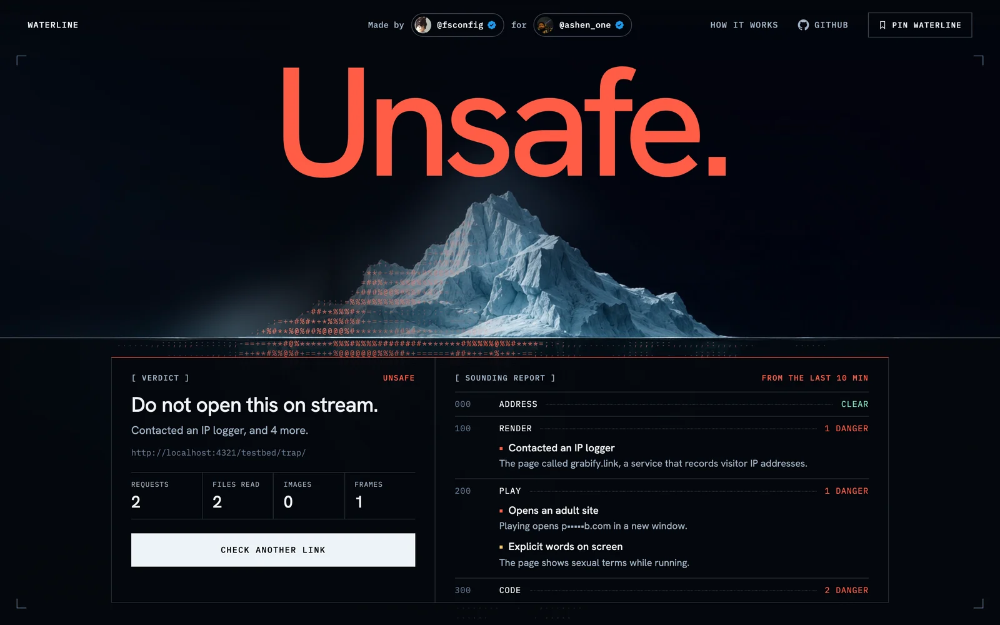

<p align="center">
  
</p>

<h1 align="center">Waterline</h1>

<p align="center">
  Check if a link is safe before it goes on stream.<br>
  Paste a link. Waterline opens it in a sealed browser, plays it, reads every script and image, and answers.
</p>

<p align="center">
  <a href="https://usewaterline.vercel.app"><b>Open Waterline</b></a>
  &nbsp;·&nbsp;
  <a href="#what-it-checks">What it checks</a>
  &nbsp;·&nbsp;
  <a href="#run-it-yourself">Run it yourself</a>
  &nbsp;·&nbsp;
  <a href="#security">Security</a>
</p>

<p align="center">
  <a href="LICENSE"></a>
  <a href="https://usewaterline.vercel.app"></a>
  <a href="https://x.com/fsconfig"></a>
</p>

<p align="center">
  <a href="https://x.com/fsconfig">
    <picture>
      <source media="(prefers-color-scheme: dark)" srcset=".github/readme/made-by-dark.svg">
      
    </picture>
  </a>
</p>

<p align="center">
  
</p>

A game sent to a streamer can look like Flappy Bird on the first screen and turn into something else once Play is pressed. Waterline goes past the first screen. It plays the link the way a person would, fast-forwards its timers, and reads what it loads, so the surprise shows up in the report instead of on stream.

Made for [@ashen_one](https://x.com/ashen_one).

## What it checks

Every link is sounded at six depths.

| Depth | | What happens |
| --- | --- | --- |
| 000 | Address | Unwraps short links. Flags look-alike names, bare IPs, known adult hosts, brand-new domains and private networks. |
| 100 | Render | Opens the link in headless Chromium that cannot download files, use a camera or reach a private network. Every request is logged. |
| 200 | Play | Clicks Play or Start, taps the canvas, presses the usual game keys, then fast-forwards the page clock by seven minutes to set off anything on a timer. Records clipboard writes, pop-ups, camera, location and download attempts. |
| 300 | Code | Reads every script and page for ClickFix commands, crypto miners, IP loggers, data-stealing webhooks, packed or encoded payloads, executable downloads and adult links. |
| 400 | Images | Checks every captured frame and every image the code can load, including images hidden inside the code as data, with an on-device NSFW model. |
| 500 | Judge | Sends what the rules flagged to [Jev](https://typesafe.ai) for a calibrated second opinion, and the suspicious script to DeepSeek for a read. |

The verdict is **Safe**, **Careful**, **Unsafe** or **Unclear**, with each finding filed under the depth where it was found. Captured frames are only ever shown pixelated, and adult domain names are masked, so the report itself is safe to show on stream.

### Keeping false positives down

Rules find candidates; the models decide. Ordinary analytics, ad scripts and obfuscated game builds are not flagged on their own. A hard rule (an IP logger call, an adult pop-up, a ClickFix command) can be softened by the models to "check", but never removed, so text planted in a page cannot talk its way to a Safe verdict.

## Run it yourself

Needs Node 20 or newer.

```sh
git clone https://github.com/noah-thing/waterline.git
cd waterline
npm install
npx playwright install chromium-headless-shell
cp .env.example .env   # add your keys
node server.mjs        # http://localhost:4321
```

| Variable | Needed | What for |
| --- | --- | --- |
| `TYPESAFE_API_KEY` | Recommended | Jev, the second opinion on flagged frames, code and text |
| `DEEPSEEK_API_KEY` | Optional | Reads the most suspicious script |
| `UPSTASH_REDIS_REST_URL`, `UPSTASH_REDIS_REST_TOKEN` | On Vercel | Shared rate limits and the result cache |
| `GOOGLE_SAFE_BROWSING_KEY` | Optional | Checks the link against Google's unsafe list |
| `WL_SALT` | On Vercel | Salt for the hashed visitor IDs |

Without any keys Waterline still runs the browser, the rules and the on-device image model.

`testbed/` has three pages to try it on: a clean game, a ClickFix page, and a Flappy-style game that turns hostile 60 seconds after Play. Start the server with `WL_ALLOW_LOCAL=1` to scan them; that switch is ignored on Vercel.

### Deploy

```sh
vercel link
vercel env add TYPESAFE_API_KEY production --sensitive
vercel integration add upstash/upstash-kv
vercel deploy --prod
```

On Vercel the API refuses to scan until the Upstash store is connected, so limits always hold across instances.

## Security

- **Sealed browser.** All of Chromium's traffic goes through a proxy inside the function. Each host is resolved once, checked against private and reserved ranges, and the connection goes to that exact address, so redirects, iframes and DNS rebinding cannot reach internal services. QUIC is off and WebRTC cannot send UDP around the proxy.
- **Keys stay on the server.** API keys live in encrypted environment variables and are never sent to the browser. The headless browser is started with a stripped environment that holds no keys.
- **Fair use.** Six scans per person every ten minutes and forty a day, one at a time, with a daily budget across everyone. People are told apart by a salted hash of their IP (IPv6 by /48), and nothing else is stored.
- **Strict page.** A content security policy with no third-party scripts, styles or fonts, no framing, and every scan result written as text, never as HTML.

Found a problem? Open an issue, or for anything sensitive, message [@fsconfig](https://x.com/fsconfig) on X.


## License

[MIT](LICENSE)
